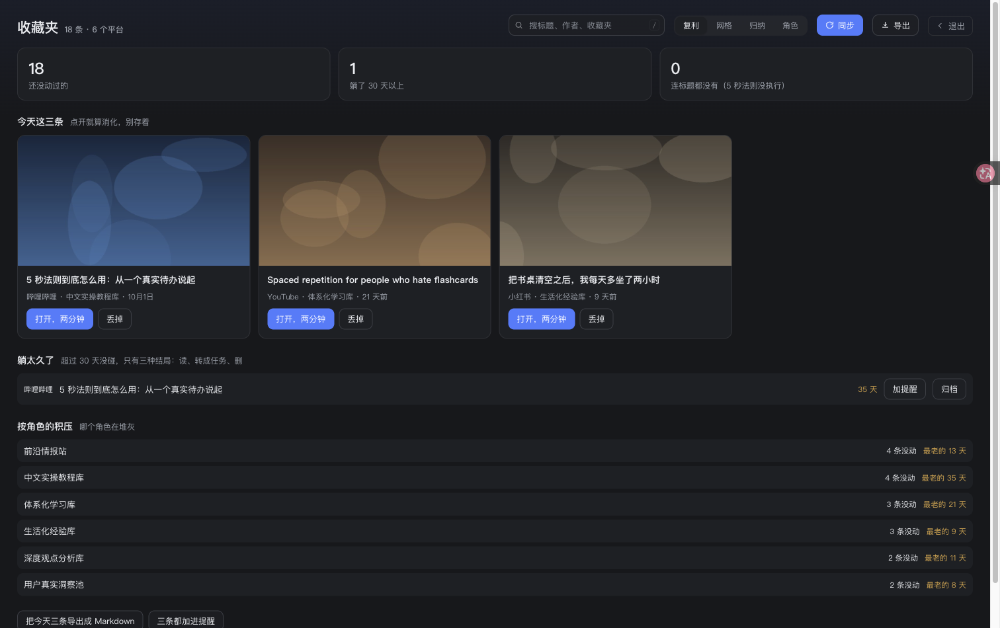
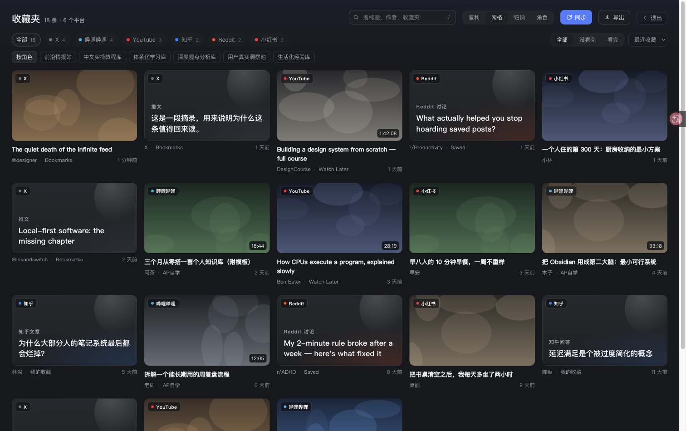
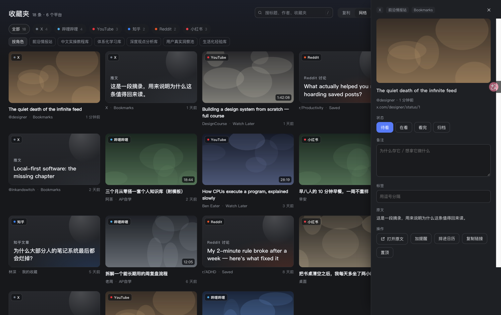

# 收藏夹中枢 · dsh-bookmarks

**六个平台的收藏，一个页面，一套消化流程。** 长在 DeepSeek Harness 里，不装第七个 App。

X · YouTube · Reddit · B 站 · 知乎 · 小红书 —— 拉进同一个本地仓，按「今天该读什么」排给你，读完能一键落到 Obsidian、提醒事项、日历。

[Fricless](https://github.com/shawnclink/fricless) 的一个实例：砍掉 API key、砍掉 cookie 导出、砍掉导入导出、砍掉「稍后再看」队列。剩下几层、怎么砍的，见 [FRICLESS.md](FRICLESS.md)。



---

## 它解决的问题

收藏夹的问题从来不是「存不下」，是**存进去就再也不出来**。六个平台六套队列，每个都叫「稍后再看」，每个都没人再看。

所以这里的第一原则是：**不提供「待读列表」**。打开就是「今天这三条」，读、丢，两个按钮。剩下的按「躺了多久」「连标题都没起」自动揪出来。

| 视图 | 回答的问题 |
|:--|:--|
| **复利**（默认） | 我今天该消化什么？哪些在堆灰？哪个角色积压最多？ |
| **网格** | 我到底存了什么？按平台 / 收藏夹 / 角色 / 状态筛。 |
| **归纳** | 这批东西整体在讲什么（读 `~/.dsh-bookmarks/digest.md`）。 |
| **角色** | 每个平台在我这儿是什么用途，消化强度多大。 |



## 走出收藏夹

收藏的价值在回流，不在数量。每条都有出口，全部本机、不联网：

- **导出 Markdown** —— 写到 `~/.dsh-bookmarks/exports/`，同时写一份进 Obsidian（默认 `fricless/05-收藏复利/`，路径可改）。按角色分节，带来源、日期、时长、收藏夹、我的备注。
- **加提醒** —— `osascript` 写进「提醒」App 的「收藏夹」列表，正文带原文链接和备注。
- **排进日历** —— 默认明天 20:00，20 分钟一个块，标题是「读：…」。
- **自动巡检** —— 每 6 小时（可关）自己同步一次，新进来的条目追加到 `~/.dsh-bookmarks/inbox/YYYY-MM-DD.md`。不弹窗、不打扰。



## 采集：不申请 API，不抠 cookie

全部走 [opencli](https://github.com/jackwener/opencli) 2.x 的 Browser Bridge —— 一个 Chrome 扩展，复用浏览器里**已经登录的会话**。

| 平台 | 取的是什么 | 说明 |
|:--|:--|:--|
| X | 书签 / Bookmarks | 默认 300 条上限，我的 240 条已全量 |
| YouTube | 稍后再看 / Watch Later | 官方 Data API 封死了这个列表，只能走浏览器 |
| Reddit | Saved posts | 上限 50 |
| Bilibili | **全部自建收藏夹** | 逐夹翻页，走原生接口，带封面 / 时长 / 播放量 |
| 知乎 | 收藏夹 | 20 条上限，逐夹拉 |
| 小红书 | 收藏笔记 | 读收藏页 DOM，封面是签名链接，过期自动退成文字卡 |

代价：Chrome 得开着、扩展得装着。这是唯一前提。

**为什么不走 API**：X 的 Bookmarks 接口按量计费（Posts:Read `$0.005`/条，5000 条约 `$25`，`$200` 档已取消）；YouTube Data API 直接返回 `403 watchLaterNotAccessible`；B 站 / 知乎 / 小红书没有公开接口。
**为什么不抠 cookie 文件**：macOS 的 App 数据保护根本不让你读 Chrome 的 Cookies 库 —— 能读的只有用户自己的终端和浏览器扩展，后者就是这条路。

## 装

需求：DeepSeek Harness 桌面版、Node 22+、`opencli` 2.0.2+、Chrome / Chromium 装着 opencli 扩展并登录好这六个平台。

```bash
npm install -g --allow-scripts=@jackwener/opencli @jackwener/opencli@latest
opencli doctor          # 要看到 extensionConnected: true
```

把包目录装成 DSH 插件：

```
plugin_manager(action: "install_bundle", target: "/绝对路径/packages/dsh-bookmarks")
```

左侧栏出现书签图标即可。改完代码不用重启 app：把插件 disable → enable 一次，Host 和 Client 两半一起热重载。

## 给模型用的工具

插件注册六个工具，在对话里可以直接指挥：

| 工具 | 干什么 |
|:--|:--|
| `bookmarks_sync` | 拉一次，可指定平台 |
| `bookmarks_list` | 按平台 / 收藏夹 / 角色 / 状态 / 关键词查 |
| `bookmarks_update` | 批量改状态、标签、备注、摘要 |
| `bookmarks_import` | 手动塞一条链接进来 |
| `bookmarks_export` | 导出 Markdown（可只导一批 id） |
| `bookmarks_review` | 未读多少、躺了多久、哪些连标题都没有 |

## 接口

页面和宿主之间走同源 HTTP，不是 RPC——简单、可 curl、可调试：

```
GET  /dsh-bookmarks/v2/api/state                全部条目 + 平台元数据 + 同步状态
POST /dsh-bookmarks/v2/api/sync                 { platforms?: string[] }
POST /dsh-bookmarks/v2/api/item                 { id, patch }
POST /dsh-bookmarks/v2/api/import               { url, platform? }
GET  /dsh-bookmarks/v2/api/digest               读 digest.md
POST /dsh-bookmarks/v2/api/digest               写 digest.md
POST /dsh-bookmarks/v2/api/settings             { settings }
POST /dsh-bookmarks/v2/api/export               { ids? | filter?, title? }
POST /dsh-bookmarks/v2/api/remind               { ids }
POST /dsh-bookmarks/v2/api/calendar             { ids }
POST /dsh-bookmarks/v2/api/reveal               { path }
```

## 已知缺口

- **小红书封面**是带签名的 CDN 链接，放久了失效，界面退回文字卡而不是破图。
- **样式**：这是「文件型」客户端插件，没有 `ctx.styles`（那是动态半边才有的），样式是自己往 `document.head` 插 `<style data-dsh-bookmarks>` 的。
- **额度**：知乎 20、Reddit 50、X 300 是额度上限，不是平台总数；B 站 600。
- **没有增量**：每次同步是全量覆盖式合并（按 URL hash 去重，不会重复，只更新 `lastSeen`），几个 CLI 都没有「只拉上次之后」的参数。
- **只有桌面**。没有手机端、没有独立 App，这是刻意的。

## 改完代码怎么生效（桌面版没有 Cmd+R）

DSH 桌面 app 的渲染层没有刷新快捷键。正确做法：

```
plugin_manager set_plugin { target: 'include:dsh-bookmarks', enabled: false }
plugin_manager set_plugin { target: 'include:dsh-bookmarks', enabled: true }
```

这一开一关会同时热重载 Host 和 Client 两半。验证：
`cordis_inspect_query { platform: 'client', provider: 'Slots', method: 'listSubTree', input: { root: 'sidebar.panellist' } }` 里应出现 `{"id": "bookmarks", "order": 20, "active": true}`。

## 许可

MIT
